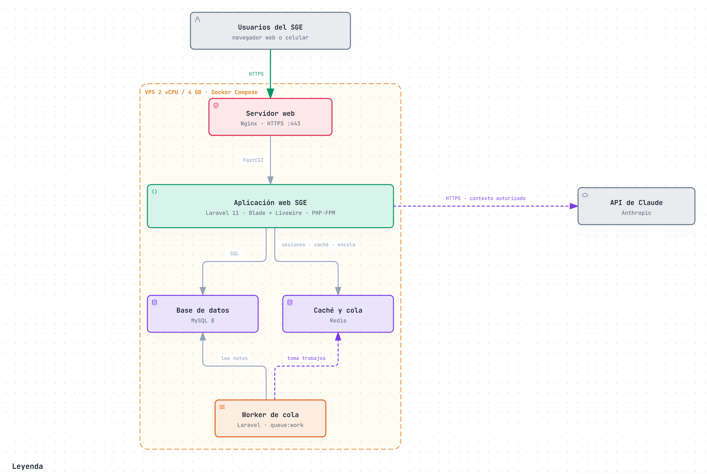

# Sistema de Gestión Escolar (SGE)

## Nombre

Berrocal Yucra, Jorge Luis

## Descripción

Sistema web genérico, ligero y adaptable que permite a instituciones educativas públicas y privadas de primaria y secundaria del Perú digitalizar sus procesos académicos esenciales: **matrícula, asistencia y evaluación**, con control de acceso basado en roles (RBAC) y un **asistente virtual con IA** para padres de familia y alumnos.

El proyecto se plantea como un **Producto Mínimo Viable (MVP)** de 6 módulos:

| N.° | Módulo |
|-----|--------|
| 1 | Autenticación y Roles (RBAC) |
| 2 | Gestión Académica Base |
| 3 | Matrícula |
| 4 | Asistencia |
| 5 | Evaluación y Boletas |
| 6 | Asistente Virtual (Chatbot IA) |

## Caso de estudio

Sistema de Gestión Escolar (SGE) para instituciones educativas de primaria y secundaria, con estructura académica configurable (niveles, grados, secciones y evaluación por competencias según el Currículo Nacional).

## Curso

Arquitectura de Software (IS-488) — Docente: Ing. Lizbeth Jaico Quispe — Semestre 2026-II

## Estructura del repositorio

```
SGE-arquitSoft-02-JorgeBerrocal/
├── docs/                                   Documentación del proyecto
│   ├── 01-analisis-de-sistema/
│   │   ├── 00-necesidad-del-negocio.md
│   │   ├── 01-actores.md
│   │   ├── 02-historias-del-usuario.md
│   │   ├── 03-requisitos-funcionales.md
│   │   ├── 04-atributos-de-calidad.md
│   │   ├── 05-restricciones.md
│   │   ├── 06-driver-arquitectonicos.md
│   │   ├── 07-decisiones-arquitectonicas.md
│   │   └── 08-escenarios-atributos-calidad.md
│   ├── 02-arquitectura-software/
│   │   ├── arquitectura-inicial.md
│   │   ├── estilo-arquitectonico.md
│   │   ├── enfoque-arquitectonico.md
│   │   └── componentes-arquitectonicos.md
│   ├── 03-diseno-de-software/
│   │   └── diseno-interno/
│   │       ├── diseno-interno-de-modulos.md
│   │       ├── patrones-de-diseno.md
│   │       └── principios-de-diseno.md
│   ├── 04-modelo-c4/
│   │   ├── Nivel1-DiagramadeContextodelSistema.md
│   │   ├── Nivel2-DiagramadeContenedores.md
│   │   ├── Nivel3-Diagrama-de-Componentes.md
│   │   └── Nivel4-DiagramadeCodigo.md
│   └── img/                                Diagramas en PNG
│       └── fuentes/                        Fuentes Archify (.archify.json) y versiones interactivas (.html)
├── tecnologia/                             Recursos tecnológicos
│   ├── ejemplo-clean-architecture/         Módulo Evaluación en PHP 8.3 con pruebas Pest
│   └── pruebas-carga/
│       └── k6-1000-usuarios.js
├── .gitignore
└── README.md
```

## Documentación

### 1. Análisis del sistema

| Entregable | Documento |
|------------|-----------|
| Necesidad del negocio | [`00-necesidad-del-negocio.md`](docs/01-analisis-de-sistema/00-necesidad-del-negocio.md) |
| Actores e historias de usuario | [`01-actores.md`](docs/01-analisis-de-sistema/01-actores.md) · [`02-historias-del-usuario.md`](docs/01-analisis-de-sistema/02-historias-del-usuario.md) |
| Requisitos funcionales y restricciones | [`03-requisitos-funcionales.md`](docs/01-analisis-de-sistema/03-requisitos-funcionales.md) · [`05-restricciones.md`](docs/01-analisis-de-sistema/05-restricciones.md) |
| Atributos de calidad y escenarios medibles | [`04-atributos-de-calidad.md`](docs/01-analisis-de-sistema/04-atributos-de-calidad.md) · [`08-escenarios-atributos-calidad.md`](docs/01-analisis-de-sistema/08-escenarios-atributos-calidad.md) |
| Drivers arquitectónicos | [`06-driver-arquitectonicos.md`](docs/01-analisis-de-sistema/06-driver-arquitectonicos.md) |
| Decisiones arquitectónicas (ADR) | [`07-decisiones-arquitectonicas.md`](docs/01-analisis-de-sistema/07-decisiones-arquitectonicas.md) |

### 2. Arquitectura de software

| Entregable | Documento |
|------------|-----------|
| Arquitectura inicial (Guía 02) | [`arquitectura-inicial.md`](docs/02-arquitectura-software/arquitectura-inicial.md) |
| Estilo arquitectónico | [`estilo-arquitectonico.md`](docs/02-arquitectura-software/estilo-arquitectonico.md) |
| Enfoque arquitectónico (Clean Architecture) | [`enfoque-arquitectonico.md`](docs/02-arquitectura-software/enfoque-arquitectonico.md) |
| Componentes arquitectónicos | [`componentes-arquitectonicos.md`](docs/02-arquitectura-software/componentes-arquitectonicos.md) |

### 3. Diseño de software

| Entregable | Documento |
|------------|-----------|
| Diseño interno de módulos | [`diseno-interno-de-modulos.md`](docs/03-diseno-de-software/diseno-interno/diseno-interno-de-modulos.md) |
| Patrones de diseño | [`patrones-de-diseno.md`](docs/03-diseno-de-software/diseno-interno/patrones-de-diseno.md) |
| Principios SOLID | [`principios-de-diseno.md`](docs/03-diseno-de-software/diseno-interno/principios-de-diseno.md) |

### 4. Modelo C4

| Nivel | Documento |
|-------|-----------|
| 1. Contexto | [`Nivel1-DiagramadeContextodelSistema.md`](docs/04-modelo-c4/Nivel1-DiagramadeContextodelSistema.md) |
| 2. Contenedores | [`Nivel2-DiagramadeContenedores.md`](docs/04-modelo-c4/Nivel2-DiagramadeContenedores.md) |
| 3. Componentes | [`Nivel3-Diagrama-de-Componentes.md`](docs/04-modelo-c4/Nivel3-Diagrama-de-Componentes.md) |
| 4. Código | [`Nivel4-DiagramadeCodigo.md`](docs/04-modelo-c4/Nivel4-DiagramadeCodigo.md) |

## Tecnología

| Recurso | Ubicación |
|---------|-----------|
| Ejemplo de Clean Architecture (módulo Evaluación, PHP 8.3 + Pest) | [`tecnologia/ejemplo-clean-architecture/`](tecnologia/ejemplo-clean-architecture/) |
| Script de prueba de carga con k6 (1000 usuarios) | [`tecnologia/pruebas-carga/k6-1000-usuarios.js`](tecnologia/pruebas-carga/k6-1000-usuarios.js) |

## Diagrama de contenedores (C4 nivel 2)



Diagramas generados con [Archify](https://github.com/tt-a1i/archify). Las versiones interactivas están en [`docs/img/fuentes/`](docs/img/fuentes/).
