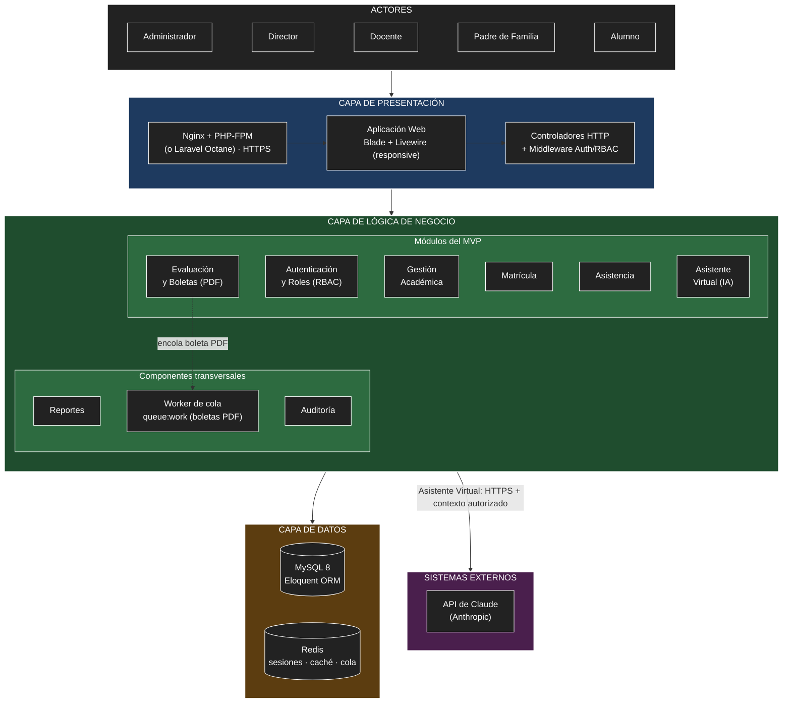

# Arquitectura inicial del sistema

Primera propuesta de arquitectura del **Sistema de Gestión Escolar (SGE)**, elaborada a partir del análisis de la carpeta [`analisis-de-sistema/`](../analisis-de-sistema/). Se adopta una **arquitectura en tres capas** dentro de un **monolito modular** en Laravel, en respuesta a los drivers DA01–DA08. La arquitectura incluye los componentes necesarios para la **prueba de carga de 1000 usuarios simultáneos** (DA03): Nginx + PHP-FPM, Redis y una cola de trabajos para las boletas PDF.

## 1. Estilo arquitectónico

El SGE es un **monolito modular organizado en tres capas**. Cada término describe algo distinto:

| Término | Qué describe | En el SGE |
|---------|--------------|-----------|
| **Monolito** | Cómo se despliega | Una sola aplicación Laravel (una misma imagen Docker) |
| **En capas** | División horizontal por responsabilidad técnica | Presentación → Lógica de negocio → Datos |
| **Modular** | División vertical por área de negocio | Autenticación, Gestión Académica, Matrícula, Asistencia, Evaluación y Asistente IA |

Cada módulo atraviesa las tres capas. Por ejemplo, cuando un docente registra una nota: el formulario de Evaluación y el middleware RBAC (presentación) → el servicio de Evaluación valida la escala y calcula el promedio (negocio) → Eloquent guarda en MySQL (datos).

- Las **capas** permiten cambiar la interfaz sin tocar las reglas y probar la lógica sin base de datos (AC05, AC07).
- Los **módulos** permiten agregar otro (p. ej. Pensiones) sin romper los demás (AC05).
- Es un **monolito** y no microservicios por las restricciones: dos meses de plazo (RC10) y un VPS de bajo costo (RC09).

Redis, la cola de trabajos y Nginx + PHP-FPM **no cambian el estilo**: siguen siendo una sola aplicación y una sola base de código. El worker de la cola ejecuta el mismo código Laravel en otro proceso, y Redis es un almacén más de la capa de datos.

## 2. Capas y pregunta que responde cada una

| Capa | Pregunta que responde | Tecnología |
|------|-----------------------|------------|
| **Presentación** | ¿Cómo interactúa el usuario? | Vistas Blade + Livewire (responsive), rutas y controladores HTTP, middleware de autenticación y permisos; servidas por Nginx + PHP-FPM (o Laravel Octane) |
| **Lógica de negocio** | ¿Qué hace el sistema? | Clases de servicio de Laravel organizadas por módulo; trabajos en cola (`queue:work`) para las tareas pesadas |
| **Datos** | ¿Dónde se almacena la información? | MySQL 8 mediante el ORM Eloquent y migraciones versionadas; Redis para sesiones, caché y cola de trabajos |

## 3. Módulos y responsabilidades

| Capa | Módulo / componente | Responsabilidad | Requisitos |
|------|---------------------|-----------------|------------|
| Presentación | Servidor web: Nginx + PHP-FPM (o Laravel Octane) | Punto de entrada: termina HTTPS, sirve los archivos estáticos y ejecuta la aplicación con OPcache. Reemplaza al servidor de desarrollo de Sail en producción. | — (RC08, RC16) |
| Presentación | Aplicación Web (Blade + Livewire) | Pantallas por rol: panel de administración, registro de asistencia y notas, consulta de boletas, chat del asistente. | RF01–RF22 |
| Presentación | Controladores y middleware | Recibir solicitudes HTTP, validar formularios, verificar sesión y permisos (RBAC) antes de invocar a los servicios. | RF01, RF02 |
| Negocio | **Autenticación y Roles (RBAC)** | Inicio de sesión, gestión de usuarios, roles y permisos configurables. | RF01–RF04 |
| Negocio | **Gestión Académica** | Institución, año escolar, periodos, escala de calificación, niveles, grados, secciones, cursos y asignación docente. | RF05–RF08 |
| Negocio | **Matrícula** | Registro de estudiantes y apoderados, matrícula por sección y traslados con historial. | RF09–RF11 |
| Negocio | **Asistencia** | Registro diario por sección/curso, tipos de asistencia y reportes. | RF12–RF14 |
| Negocio | **Evaluación y Boletas** | Notas por competencia, validación de escala, cálculo de promedios y boleta PDF: encola la generación y entrega el archivo ya generado. | RF15–RF18 |
| Negocio | **Worker de cola** (`queue:work`) | Proceso aparte que ejecuta el mismo código de Evaluación para generar las boletas PDF fuera de la solicitud HTTP y guardarlas en el almacenamiento de la aplicación. | RF17 |
| Negocio | **Asistente Virtual (IA)** | Recuperar solo los datos autorizados del usuario, construir el contexto y consultar la API de Claude. El cliente de la API queda detrás de una interfaz, para sustituirlo por una respuesta simulada en la prueba de carga (RC18). | RF19, RF20 |
| Negocio | **Reportes** | Reportes consolidados de matrícula, asistencia y rendimiento para el director. | RF21 |
| Negocio | **Auditoría** (transversal) | Registrar acciones críticas: inicio de sesión, cambios de notas y gestión de usuarios. | RF22 |
| Datos | Base de datos MySQL | Usuarios, roles, permisos, estructura académica, estudiantes, apoderados, matrículas, asistencias, calificaciones y bitácora de auditoría. Con índices en las columnas de consulta frecuente. | — |
| Datos | Redis | Sesiones de usuario, caché (permisos RBAC, estructura académica) y cola de trabajos. | — |
| Externo | API de Claude (Anthropic) | Generar respuestas en lenguaje natural para el asistente virtual. | RF19 |

## 4. Dependencias entre módulos

- Todos los módulos dependen de **Autenticación y Roles** para verificar permisos (DA01).
- **Matrícula**, **Asistencia** y **Evaluación** dependen de **Gestión Académica** (grados, secciones, cursos, periodos y escala) (DA04).
- **Asistencia** y **Evaluación** dependen de **Matrícula** (qué estudiantes pertenecen a cada sección).
- **Asistente Virtual** consulta los datos de **Asistencia**, **Evaluación** y **Gestión Académica** filtrados por RBAC, y es el **único** módulo que se comunica con un sistema externo (DA02).
- **Reportes** lee información de Matrícula, Asistencia y Evaluación.
- **Evaluación** encola en **Redis** la generación de cada boleta PDF; el **Worker de cola** toma el trabajo, lee las notas mediante Eloquent y guarda el PDF. La descarga solo entrega el archivo ya generado (DA03).
- **Autenticación y Roles** guarda las sesiones en **Redis**; los permisos RBAC y la estructura académica de **Gestión Académica** se leen desde la caché de Redis y, si no están, desde MySQL (DA03).
- **Nginx + PHP-FPM** recibe todas las solicitudes HTTPS y las entrega a la aplicación; ningún módulo es accesible sin pasar por él (RC08, RC16).
- **Auditoría** recibe eventos de Autenticación, Evaluación y gestión de usuarios (DA08).
- Cada capa solo se comunica con la **capa inmediata inferior**.

## 5. Diagrama de arquitectura (vista simplificada)

```
┌──────────────────────────────────────────────────────────────┐
│                           ACTORES                            │
│Administrador │ Director │ Docente │ Padre de Familia │ Alumno│
└──────────────────────────────────────────────────────────────┘
                              ↓ HTTPS
┌──────────────────────────────────────────────────────────────┐
│                         PRESENTACIÓN                         │
│              Nginx + PHP-FPM (o Laravel Octane)              │
│   Aplicación Web (Blade + Livewire) → Controladores / RBAC   │
└──────────────────────────────────────────────────────────────┘
                              ↓
┌──────────────────────────────────────────────────────────────┐
│                      LÓGICA DE NEGOCIO                       │
│    Autenticación y Roles │ Gestión Académica │ Matrícula     │
│  Asistencia │ Evaluación y Boletas │ Asistente Virtual (IA)  │
│     Reportes │ Auditoría │ Worker de cola (boletas PDF)      │
└──────────────────────────────────────────────────────────────┘
                 ↓                                 │
┌─────────────────────────────────┐                │ integración
│              DATOS              │                ▼
│      MySQL 8 (Eloquent ORM)     │   ┌──────────────────────────┐
│ Redis (sesiones · caché · cola) │   │    SISTEMAS EXTERNOS     │
└─────────────────────────────────┘   │ API de Claude (Anthropic)│
                                      └──────────────────────────┘
```

## 6. Diagrama de arquitectura (Archify)

Diagrama interactivo generado con la skill [Archify](https://github.com/tt-a1i/archify) (MIT). Archify parte de una especificación JSON tipada, la valida contra su esquema, revisa la composición (cruces de líneas, etiquetas, legibilidad) y entrega un HTML autocontenido con tema claro/oscuro, enfoque por nodo, trazado de rutas y exportación a PNG/SVG.


| Archivo | Contenido |
|---------|-----------|
| [`archify/sge-arquitectura.archify.json`](archify/sge-arquitectura.archify.json) | Especificación fuente del diagrama (componentes, capas, relaciones y tarjetas) |
| [`archify/sge-arquitectura.html`](archify/sge-arquitectura.html) | Diagrama interactivo (descargar y abrir en el navegador) |
| [`archify/sge-arquitectura.png`](archify/sge-arquitectura.png) | Imagen estática para el README y documentos |

### Cambios respecto a la versión inicial

| Cambio | Motivo |
|--------|--------|
| Se agrega el **proxy HTTPS (Caddy/Nginx)** entre los usuarios y la aplicación. | Hace visible la restricción RC16 (HTTPS con Let's Encrypt) y el punto de entrada del despliegue Docker (DA06). |
| Los 8 módulos se agrupan en **4 subsistemas**: *Auth/RBAC + Auditoría*, *Gestión Académica* (M2–M3), *Asistencia y Evaluación* (M4–M5 + Reportes) y *Asistente Virtual IA* (M6). | Agrupa módulos que cooperan y comparten datos; reduce el acoplamiento visual y deja claras las responsabilidades de cada bloque (AC05). |
| El **Asistente IA ya no accede directo a la base de datos**: consulta a *Asistencia y Evaluación* solo los datos que el RBAC permite. | Refuerza el driver DA02: un único punto controlado decide qué información se envía a la IA. |
| Se separa **Eloquent ORM** de **MySQL 8** dentro de la capa de datos. | Muestra cómo la lógica de negocio accede a los datos sin SQL directo (migraciones versionadas, RC05). |
| La API de Claude se conecta **desde el Asistente IA** (no desde la capa de datos). | Representa correctamente quién inicia la integración externa. |

### Cambios para la prueba de carga de 1000 usuarios

| Cambio | Motivo |
|--------|--------|
| El proxy pasa a ser **Nginx + PHP-FPM** (o Laravel Octane), con OPcache. | El servidor de desarrollo de Sail no soporta la carga de la prueba (RC08, DA03). |
| Se agrega **Redis** en la capa de datos. | Sesiones y caché en memoria, para no consultar MySQL en cada solicitud; además sirve de cola de trabajos (DA03). |
| Se agrega el **Worker de cola** (`queue:work`). | Las boletas PDF se generan fuera de la solicitud HTTP y no bloquean a los demás usuarios (RF17, AC04, DA03). |

### Cómo regenerar el diagrama

```bash
# 1. Instalar la skill (una sola vez)
npx skills add tt-a1i/archify -g

# 2. Validar y generar el HTML desde la raíz del repositorio
node <ruta-de-archify>/bin/archify.mjs finalize architecture \
  arquitectura/archify/sge-arquitectura.archify.json \
  arquitectura/archify/sge-arquitectura.html --quality showcase
```

## 7. Diagrama de arquitectura (Mermaid)



## 8. Descripción

La arquitectura inicial se organiza en tres capas principales:

- **Presentación:** permite la interacción de los cinco roles con el sistema mediante una aplicación web responsive construida con Blade y Livewire. En producción, Nginx + PHP-FPM (o Laravel Octane) recibe las solicitudes HTTPS; los controladores las atienden y el middleware verifica la sesión y los permisos (RBAC) antes de llegar a la lógica de negocio.
- **Lógica de negocio:** contiene los módulos del MVP como clases de servicio independientes: autenticación y roles, gestión académica, matrícula, asistencia, evaluación y boletas, asistente virtual, reportes y auditoría. Esta separación facilita las pruebas unitarias y de integración (DA07) y la incorporación de nuevos módulos (AC05). Las boletas PDF se generan en segundo plano: Evaluación encola el trabajo y un worker (`queue:work`) lo procesa, de modo que la solicitud del usuario no espera al PDF (DA03).
- **Datos:** almacena y consulta la información en una base de datos MySQL 8 mediante Eloquent, con un modelo genérico y configurable de la estructura académica (DA04). Redis guarda las sesiones, la caché y la cola de trabajos, para reducir las consultas a MySQL bajo carga (DA03).

Además, el módulo de **Asistente Virtual (IA)** es el único que se integra con un sistema externo, la **API de Claude (Anthropic)**. Antes de cada consulta, recupera de la base de datos solo la información permitida para el usuario autenticado y la envía como contexto por HTTPS, evitando exponer datos de otros estudiantes (DA02).

## 9. Relación con los drivers arquitectónicos

| Driver | Decisión arquitectónica |
|--------|-------------------------|
| DA01 RBAC configurable | Middleware/policies en Presentación + módulo Autenticación y Roles usado por todos los módulos. |
| DA02 IA con privacidad | Módulo Asistente Virtual que filtra datos por RBAC antes de llamar a la API externa; cliente de la API detrás de una interfaz, sustituible por una respuesta simulada (RC18). |
| DA03 Rendimiento con 1000 usuarios simultáneos | Nginx + PHP-FPM (u Octane) con OPcache; Redis para sesiones y caché; cola con worker para las boletas PDF; índices en MySQL, eager loading y paginación; validación con k6 en un VPS de 2 vCPU / 4 GB (ver sección 10). |
| DA04 Estructura configurable | Módulo Gestión Académica como base de Matrícula, Asistencia y Evaluación. |
| DA05 Laravel + Blade/Livewire | Arquitectura en tres capas dentro de un monolito modular. |
| DA06 Docker de bajo costo | Pocos contenedores: Nginx, aplicación (PHP-FPM), worker de cola, MySQL y Redis. La aplicación y el worker usan la misma imagen. |
| DA07 Testeabilidad | Lógica en clases de servicio aisladas, probadas con Pest/PHPUnit. |
| DA08 Auditoría | Componente transversal de Auditoría con registro en la base de datos. |

## 10. Estrategia para la prueba de carga

La docente aplicará una **prueba de carga con 1000 usuarios simultáneos** (AC03, DA03). Todas las cifras de esta sección son **metas y estimaciones**; los valores reales se obtendrán midiendo con k6.

### Qué significa "1000 usuarios"

1000 usuarios virtuales en k6 no equivalen a 1000 solicitudes por segundo. Con pausas de 2 a 5 segundos entre acciones se estiman unas 200–300 solicitudes por segundo. Sin pausas y entrando todos a la vez serían más de 1000 por segundo, algo difícil de sostener en cualquier servidor pequeño. Por eso la meta se define **con subida gradual (ramp-up) y pausas entre acciones**.

**Meta:** percentil 95 del tiempo de respuesta menor a 2 segundos y menos de 1 % de solicitudes con error.

### Cuellos de botella identificados

| # | Cuello de botella | Por qué afecta |
|---|-------------------|----------------|
| 1 | Servidor de desarrollo de Laravel Sail | No está pensado para producción ni para atender muchas solicitudes en paralelo. |
| 2 | Inicio de sesión masivo | El hash de contraseñas (bcrypt) es costoso a propósito: se estiman 10–20 inicios de sesión por segundo por núcleo. 1000 en el mismo segundo generan cola y tiempos de espera agotados. |
| 3 | Boletas PDF generadas en el momento | Cada PDF consume aproximadamente 0,5–2 s de CPU y 50–100 MB de RAM. |
| 4 | Memoria del servidor | Con 2 GB, MySQL (~500 MB) deja espacio para solo unos 15–25 procesos PHP de 40–60 MB. |
| 5 | Asistente virtual | La API de Claude tiene límites de solicitudes y un costo por consulta. |
| 6 | Límite de solicitudes de Laravel (rate limiting) | k6 envía todo desde una sola IP y puede recibir errores 429 que no son caídas reales. |

### Ajustes de la arquitectura (por impacto)

| # | Ajuste | Capa | Cuello que resuelve | Trazabilidad |
|---|--------|------|---------------------|--------------|
| 1 | Nginx + PHP-FPM (o Laravel Octane), OPcache y `php artisan optimize` | Presentación / despliegue | 1 | RC08 |
| 2 | Redis para sesiones y caché | Datos | 4 | DA03 |
| 3 | Boletas PDF pregeneradas o en cola (`queue:work`) | Negocio (Evaluación) | 3 | RF17, AC04 |
| 4 | Índices en MySQL, eager loading (`with()`) para evitar consultas N+1 y paginación | Datos | 4 | DA03 |
| 5 | VPS de 2 vCPU / 4 GB para la prueba | Infraestructura | 2, 4 | RC09 |
| 6 | Asistente virtual excluido de la prueba o con respuesta simulada | Negocio (Asistente IA) | 5 | RC18 |
| 7 | Subida gradual (ramp-up) y ajuste del límite de solicitudes para la IP de k6 | Pruebas | 2, 6 | AC03 |
| 8 | Pruebas propias en escalones 100 → 300 → 600 → 1000 usuarios antes de la prueba oficial | Pruebas | — | RC12 |

### Script k6 de referencia

El script completo está en [`pruebas/carga/k6-1000-usuarios.js`](../pruebas/carga/k6-1000-usuarios.js). Su configuración central es:

```javascript
export const options = {
  stages: [
    { duration: '2m', target: 300 },   // subida gradual hasta 300 usuarios
    { duration: '3m', target: 1000 },  // subida hasta 1000 usuarios
    { duration: '5m', target: 1000 },  // carga sostenida
    { duration: '1m', target: 0 },     // bajada
  ],
  thresholds: {
    http_req_duration: ['p(95)<2000'], // p95 menor a 2 s
    http_req_failed: ['rate<0.01'],    // menos de 1 % de errores
  },
};
```

Cada usuario virtual inicia sesión una vez y luego consulta notas, asistencia y su boleta, con pausas aleatorias de 2 a 5 segundos. Las rutas del script son provisionales hasta que exista la aplicación. Se ejecuta con:

```bash
k6 run -e BASE_URL=https://tu-dominio -e CLAVE=<clave-de-prueba> pruebas/carga/k6-1000-usuarios.js
```

### Pendiente de confirmar con la docente

- Duración del ramp-up y de la carga sostenida.
- Pausas entre acciones de cada usuario.
- Pantallas o endpoints que se probarán.
