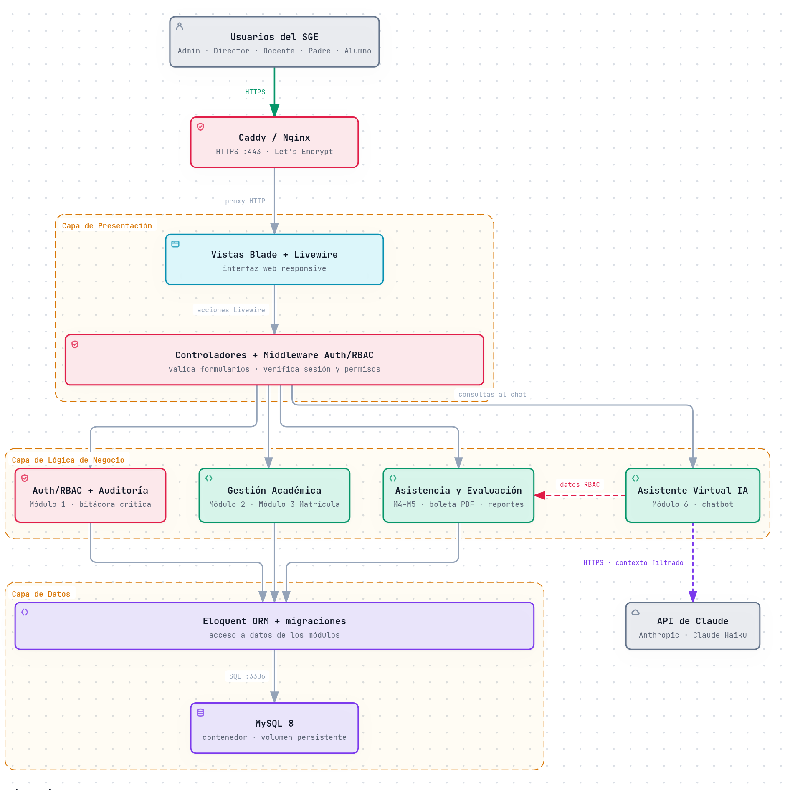
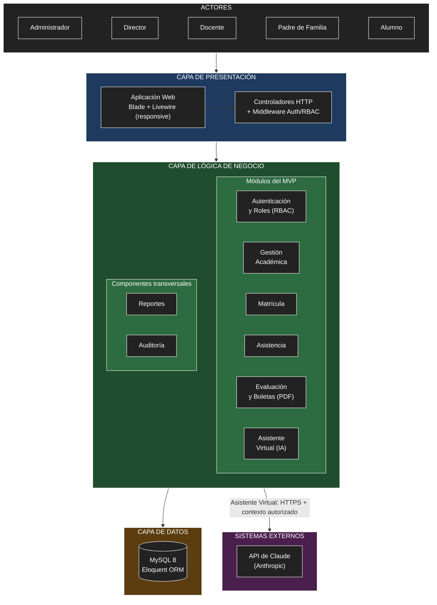

# Arquitectura inicial del sistema

Primera propuesta de arquitectura del **Sistema de Gestión Escolar (SGE)**, elaborada a partir del análisis de la carpeta [`analisis-de-sistema/`](../analisis-de-sistema/). Se adopta una **arquitectura en tres capas** dentro de un **monolito modular** en Laravel, en respuesta a los drivers DA01–DA08.

## 1. Capas y pregunta que responde cada una

| Capa | Pregunta que responde | Tecnología |
|------|-----------------------|------------|
| **Presentación** | ¿Cómo interactúa el usuario? | Vistas Blade + Livewire (responsive), rutas y controladores HTTP, middleware de autenticación y permisos |
| **Lógica de negocio** | ¿Qué hace el sistema? | Clases de servicio de Laravel organizadas por módulo |
| **Datos** | ¿Dónde se almacena la información? | MySQL 8 mediante el ORM Eloquent y migraciones versionadas |

## 2. Módulos y responsabilidades

| Capa | Módulo / componente | Responsabilidad | Requisitos |
|------|---------------------|-----------------|------------|
| Presentación | Aplicación Web (Blade + Livewire) | Pantallas por rol: panel de administración, registro de asistencia y notas, consulta de boletas, chat del asistente. | RF01–RF22 |
| Presentación | Controladores y middleware | Recibir solicitudes HTTP, validar formularios, verificar sesión y permisos (RBAC) antes de invocar a los servicios. | RF01, RF02 |
| Negocio | **Autenticación y Roles (RBAC)** | Inicio de sesión, gestión de usuarios, roles y permisos configurables. | RF01–RF04 |
| Negocio | **Gestión Académica** | Institución, año escolar, periodos, escala de calificación, niveles, grados, secciones, cursos y asignación docente. | RF05–RF08 |
| Negocio | **Matrícula** | Registro de estudiantes y apoderados, matrícula por sección y traslados con historial. | RF09–RF11 |
| Negocio | **Asistencia** | Registro diario por sección/curso, tipos de asistencia y reportes. | RF12–RF14 |
| Negocio | **Evaluación y Boletas** | Notas por competencia, validación de escala, cálculo de promedios y generación de boleta PDF. | RF15–RF18 |
| Negocio | **Asistente Virtual (IA)** | Recuperar solo los datos autorizados del usuario, construir el contexto y consultar la API de Claude. | RF19, RF20 |
| Negocio | **Reportes** | Reportes consolidados de matrícula, asistencia y rendimiento para el director. | RF21 |
| Negocio | **Auditoría** (transversal) | Registrar acciones críticas: inicio de sesión, cambios de notas y gestión de usuarios. | RF22 |
| Datos | Base de datos MySQL | Usuarios, roles, permisos, estructura académica, estudiantes, apoderados, matrículas, asistencias, calificaciones y bitácora de auditoría. | — |
| Externo | API de Claude (Anthropic) | Generar respuestas en lenguaje natural para el asistente virtual. | RF19 |

## 3. Dependencias entre módulos

- Todos los módulos dependen de **Autenticación y Roles** para verificar permisos (DA01).
- **Matrícula**, **Asistencia** y **Evaluación** dependen de **Gestión Académica** (grados, secciones, cursos, periodos y escala) (DA04).
- **Asistencia** y **Evaluación** dependen de **Matrícula** (qué estudiantes pertenecen a cada sección).
- **Asistente Virtual** consulta los datos de **Asistencia**, **Evaluación** y **Gestión Académica** filtrados por RBAC, y es el **único** módulo que se comunica con un sistema externo (DA02).
- **Reportes** lee información de Matrícula, Asistencia y Evaluación.
- **Auditoría** recibe eventos de Autenticación, Evaluación y gestión de usuarios (DA08).
- Cada capa solo se comunica con la **capa inmediata inferior**.

## 4. Diagrama de arquitectura (vista simplificada)

```
┌──────────────────────────────────────────────────────────────┐
│                           ACTORES                            │
│  Administrador │ Director │ Docente │ Padre de Familia │ Alumno │
└──────────────────────────────────────────────────────────────┘
                              ↓
┌──────────────────────────────────────────────────────────────┐
│                         PRESENTACIÓN                         │
│   Aplicación Web (Blade + Livewire) → Controladores / RBAC   │
└──────────────────────────────────────────────────────────────┘
                              ↓
┌──────────────────────────────────────────────────────────────┐
│                      LÓGICA DE NEGOCIO                       │
│  Autenticación y Roles │ Gestión Académica │ Matrícula        │
│  Asistencia │ Evaluación y Boletas │ Asistente Virtual (IA)   │
│  Reportes │ Auditoría                                        │
└──────────────────────────────────────────────────────────────┘
                 ↓                                 │
┌───────────────────────────────┐                  │ integración
│             DATOS             │                  ▼
│   MySQL 8 (Eloquent ORM)      │   ┌──────────────────────────┐
└───────────────────────────────┘   │    SISTEMAS EXTERNOS     │
                                    │ API de Claude (Anthropic)│
                                    └──────────────────────────┘
```

## 5. Diagrama de arquitectura (Archify)

Diagrama interactivo generado con la skill [Archify](https://github.com/tt-a1i/archify) (MIT). Archify parte de una especificación JSON tipada, la valida contra su esquema, revisa la composición (cruces de líneas, etiquetas, legibilidad) y entrega un HTML autocontenido con tema claro/oscuro, enfoque por nodo, trazado de rutas y exportación a PNG/SVG.



| Archivo | Contenido |
|---------|-----------|
| [`archify/sge-arquitectura.archify.json`](archify/sge-arquitectura.archify.json) | Especificación fuente del diagrama (componentes, capas, relaciones y tarjetas) |
| [`archify/sge-arquitectura.html`](archify/sge-arquitectura.html) | Diagrama interactivo (descargar y abrir en el navegador) |
| [`archify/sge-arquitectura.png`](archify/sge-arquitectura.png) | Imagen estática para el README y documentos |

### Cambios respecto a la versión inicial

| Cambio | Motivo |
|--------|--------|
| Se agrega el **proxy HTTPS (Caddy/Nginx)** entre los usuarios y la aplicación. | Hace visible la restricción RC16 (HTTPS con Let's Encrypt) y el punto de entrada del despliegue Docker (DA06). |
| Los 8 módulos se agrupan en **4 subsistemas**: *Auth/RBAC + Auditoría*, *Gestión Académica* (M2–M3), *Asistencia y Evaluación* (M4–M5 + Reportes) y *Asistente Virtual IA* (M6). | Agrupa módulos que cooperan y comparten datos; reduce el acoplamiento visual y deja claras las responsabilidades de cada bloque (AC05). |
| El **Asistente IA ya no accede directo a la base de datos**: consulta a *Asistencia y Evaluación* solo los datos que el RBAC permite. | Refuerza el driver DA02: un único punto controlado decide qué información se envía a la IA. |
| Se separa **Eloquent ORM** de **MySQL 8** dentro de la capa de datos. | Muestra cómo la lógica de negocio accede a los datos sin SQL directo (migraciones versionadas, RC05). |
| La API de Claude se conecta **desde el Asistente IA** (no desde la capa de datos). | Representa correctamente quién inicia la integración externa. |

### Cómo regenerar el diagrama

```bash
# 1. Instalar la skill (una sola vez)
npx skills add tt-a1i/archify -g

# 2. Validar y generar el HTML desde la raíz del repositorio
node <ruta-de-archify>/bin/archify.mjs finalize architecture \
  arquitectura/archify/sge-arquitectura.archify.json \
  arquitectura/archify/sge-arquitectura.html --quality showcase
```

## 6. Diagrama de arquitectura (Mermaid)



## 7. Descripción

La arquitectura inicial se organiza en tres capas principales:

- **Presentación:** permite la interacción de los cinco roles con el sistema mediante una aplicación web responsive construida con Blade y Livewire. Los controladores reciben las solicitudes y el middleware verifica la sesión y los permisos (RBAC) antes de llegar a la lógica de negocio.
- **Lógica de negocio:** contiene los módulos del MVP como clases de servicio independientes: autenticación y roles, gestión académica, matrícula, asistencia, evaluación y boletas, asistente virtual, reportes y auditoría. Esta separación facilita las pruebas unitarias y de integración (DA07) y la incorporación de nuevos módulos (AC05).
- **Datos:** almacena y consulta la información en una base de datos MySQL 8 mediante Eloquent, con un modelo genérico y configurable de la estructura académica (DA04).

Además, el módulo de **Asistente Virtual (IA)** es el único que se integra con un sistema externo, la **API de Claude (Anthropic)**. Antes de cada consulta, recupera de la base de datos solo la información permitida para el usuario autenticado y la envía como contexto por HTTPS, evitando exponer datos de otros estudiantes (DA02).

## 8. Relación con los drivers arquitectónicos

| Driver | Decisión arquitectónica |
|--------|-------------------------|
| DA01 RBAC configurable | Middleware/policies en Presentación + módulo Autenticación y Roles usado por todos los módulos. |
| DA02 IA con privacidad | Módulo Asistente Virtual que filtra datos por RBAC antes de llamar a la API externa. |
| DA03 Rendimiento en VPS 2 GB | Monolito ligero, consultas eficientes con Eloquent e índices, validación con k6. |
| DA04 Estructura configurable | Módulo Gestión Académica como base de Matrícula, Asistencia y Evaluación. |
| DA05 Laravel + Blade/Livewire | Arquitectura en tres capas dentro de un monolito modular. |
| DA06 Docker de bajo costo | Pocos contenedores: aplicación, MySQL y proxy HTTPS (Caddy/Nginx). |
| DA07 Testeabilidad | Lógica en clases de servicio aisladas, probadas con Pest/PHPUnit. |
| DA08 Auditoría | Componente transversal de Auditoría con registro en la base de datos. |
