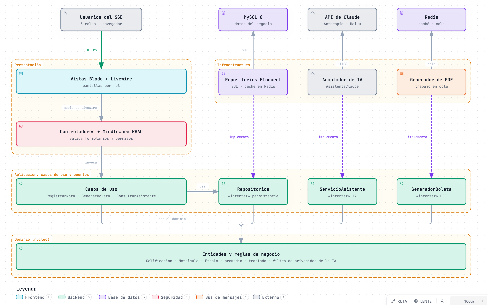

# Componentes arquitectónicos

Componentes del SGE organizados según el [enfoque arquitectónico](enfoque-arquitectonico.md) (Clean Architecture). Las flechas indican **"depende de"** y todas terminan en el Dominio.

> Fuente editable: [`img/fuentes/componentes-arquitectonicos.archify.json`](../img/fuentes/componentes-arquitectonicos.archify.json) · versión interactiva: [`componentes-arquitectonicos.html`](../img/fuentes/componentes-arquitectonicos.html)

## Componentes y de dónde salen

| Capa | Componente | Responsabilidad | Origen |
|------|------------|-----------------|--------|
| Presentación | Vistas Blade + Livewire | Pantallas de cada rol, responsive. | RF01–RF22, AC08, RC04 |
| Presentación | Controladores + Middleware RBAC | Validar formularios y verificar sesión y permisos antes de llegar a un caso de uso. | RF02, DA01 |
| Aplicación | Casos de uso | Coordinar cada operación: `RegistrarNota`, `GenerarBoleta`, `MatricularEstudiante`, `ConsultarAsistente`. | RF09–RF20, DA07 |
| Aplicación | Puertos (interfaces) | Declarar lo que la aplicación necesita del exterior: `RepositorioCalificaciones`, `ServicioAsistente`, `GeneradorBoleta`. | DA07, DA09 |
| Dominio | Entidades y reglas de negocio | Validar la escala, calcular promedios, controlar traslados y filtrar los datos que recibe la IA. | RF15, RF16, RF11, RF20, DA04 |
| Infraestructura | Repositorios Eloquent | Implementar la persistencia en MySQL y la caché en Redis. | RC05, DA03 |
| Infraestructura | Adaptador de IA | Implementar `ServicioAsistente` con la API de Claude; se sustituye por `AsistenteSimulado` en la prueba de carga. | RF19, DA02, RC07, RC18 |
| Infraestructura | Generador de PDF | Implementar `GeneradorBoleta` como trabajo en la cola de Redis. | RF17, DA03 |

## Lectura del diagrama

- **Regla de dependencia:** el Dominio no conoce a Laravel, Eloquent ni a la API de Claude. La Infraestructura implementa los puertos que define la Aplicación (inversión de dependencias, DIP).
- **Aplicación gradual (ADR-002):** este esquema completo se aplica en Evaluación y Boletas, Matrícula y Asistente IA. Los demás módulos usan los modelos Eloquent directamente desde sus casos de uso.
- Cómo se ubican estos componentes en cada módulo y en ejecución se ve en el [modelo C4](../04-modelo-c4/).
