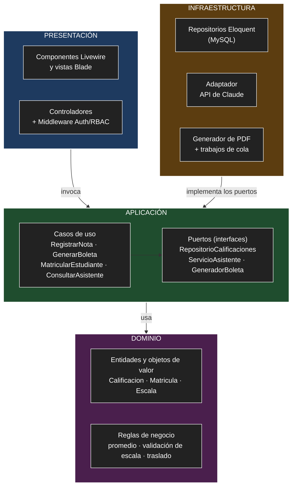

# Enfoque arquitectónico

> **Pregunta guía:** ¿Qué estructura arquitectónica aplicaremos?

El enfoque arquitectónico define **cómo se organizan las responsabilidades y las dependencias internas** del sistema. El [estilo arquitectónico](estilo-arquitectonico.md) (monolito modular en capas) dice cómo se estructura y despliega el sistema; el enfoque dice dónde vive cada responsabilidad dentro del código.

## Enfoque seleccionado

| Elemento | Descripción aplicada al SGE |
|----------|-----------------------------|
| **Patrón / enfoque arquitectónico** | Clean Architecture (Arquitectura Limpia), aplicada de forma gradual. |
| **Objetivo** | Separar responsabilidades y controlar las dependencias hacia el dominio. |
| **¿Qué problema resuelve?** | Evita el acoplamiento entre la interfaz Blade/Livewire, las reglas del negocio y las tecnologías externas: MySQL, Redis, la generación de PDF y la API de Claude. |
| **Capas definidas** | Presentación, Aplicación, Dominio e Infraestructura. |
| **Beneficios** | Facilita el mantenimiento y las pruebas unitarias (DA07, DA09). Permite cambiar implementaciones técnicas sin modificar las reglas del negocio. Mejora la organización del código. |
| **Decisión registrada** | [ADR-002](../01-analisis-de-sistema/07-decisiones-arquitectonicas.md#adr-002--clean-architecture-aplicada-de-forma-gradual) |

## La regla de dependencia

**Las dependencias del código apuntan hacia el interior.** El dominio no conoce a nadie; la aplicación solo conoce al dominio; la presentación y la infraestructura conocen a la aplicación y al dominio, pero nunca al revés.

En la práctica: una regla de negocio no puede importar una clase de Eloquent, de Livewire ni del cliente HTTP de Claude.

## Capas

| Carpeta | Capa de Clean Architecture | ¿Qué contiene? | Ejemplo en el SGE |
|---------|----------------------------|----------------|-------------------|
| `Dominio` | 1. Dominio | Entidades, objetos de valor y reglas de negocio. Sin dependencias de Laravel. | `Calificacion`, `Matricula`, `Escala`, cálculo del promedio, regla de traslado entre secciones. |
| `Aplicacion` | 2. Aplicación | Casos de uso y puertos (interfaces de repositorios y de servicios externos). | `RegistrarNota`, `GenerarBoleta`, `MatricularEstudiante`, `ConsultarAsistente`; puertos `RepositorioCalificaciones`, `ServicioAsistente`. |
| `Presentacion` | 3. Presentación / adaptadores de interfaz | Componentes Livewire, vistas Blade, controladores y validación de formularios. | Pantalla de registro de notas, consulta de boletas, chat del asistente. |
| `Infraestructura` | 4. Infraestructura / frameworks y drivers | Implementaciones concretas de los puertos. | Modelos y repositorios Eloquent, adaptador de la API de Claude, generador de PDF, trabajos de la cola. |

## Diagrama de dependencias

Las flechas indican **"depende de"**. Todas terminan en el dominio.



## Relación con las tres capas del estilo

Clean Architecture no reemplaza las capas del estilo; precisa cómo se relacionan.

| Capa del estilo | Capas de Clean Architecture | Qué cambia |
|-----------------|-----------------------------|------------|
| Presentación | Presentación | Nada: sigue invocando a la lógica de negocio. |
| Lógica de negocio | Aplicación + Dominio | Se divide en casos de uso (qué hace el sistema) y reglas puras (cómo se decide). |
| Datos | Infraestructura | **Se invierte la dependencia:** la lógica de negocio define una interfaz y la capa de datos la implementa. También incluye los adaptadores externos (Claude, PDF, cola). |

En tiempo de ejecución el flujo sigue siendo Presentación → Negocio → Datos. Lo que cambia es la dirección de las dependencias en el código.

## Estructura de carpetas propuesta

Cada módulo del monolito tiene sus propias cuatro capas:

```
app/Modulos/
├── Evaluacion/
│   ├── Dominio/            Calificacion, Escala, EscalaLiteral, EscalaVigesimal
│   ├── Aplicacion/
│   │   ├── CasosDeUso/     RegistrarNota, GenerarBoleta
│   │   └── Puertos/        RepositorioCalificaciones, GeneradorBoleta
│   ├── Infraestructura/    RepositorioCalificacionesEloquent, GeneradorBoletaPdf, GenerarBoletaJob
│   └── Presentacion/       componentes Livewire, vistas y controladores
├── Matricula/              (misma estructura)
├── AsistenteIA/            (misma estructura)
├── GestionAcademica/       Aplicacion + Presentacion + modelos Eloquent
├── Asistencia/             Aplicacion + Presentacion + modelos Eloquent
└── Autenticacion/          Aplicacion + Presentacion + modelos Eloquent
```

Es una propuesta de organización: todavía no hay código.

## Aplicación gradual por módulo

Clean Architecture completa exige entidades puras, interfaces y traductores entre el dominio y Eloquent. Ese costo solo se justifica donde hay reglas de negocio o servicios externos.

| Módulo | Nivel | Motivo |
|--------|-------|--------|
| **Evaluación y Boletas** | Completo | Reglas de escala y promedios; generación de PDF en cola (RF15–RF17). |
| **Matrícula** | Completo | Reglas de matrícula y traslado con historial (RF09–RF11). |
| **Asistente Virtual IA** | Completo | Servicio externo y regla de privacidad; debe poder simularse (DA02, RC18). |
| Autenticación y Roles | Simplificado | Se apoya en Laravel Breeze/Sanctum y en middleware (RC06). |
| Gestión Académica | Simplificado | Catálogos configurables: crear, editar y listar. |
| Asistencia | Simplificado | Registro y consulta con pocas reglas. |
| Reportes | Simplificado | Solo consultas de lectura. |
| Auditoría | Simplificado | Componente de infraestructura que escucha eventos (ADR-010). |

**Nivel completo:** Dominio sin Laravel, puertos en Aplicación e implementaciones en Infraestructura.

**Nivel simplificado:** los casos de uso usan los modelos Eloquent directamente, sin interfaces de repositorio ni entidades separadas.

### Reglas que se cumplen en todos los módulos

1. La presentación no contiene reglas de negocio: valida el formulario e invoca un caso de uso.
2. Ningún componente Livewire ni controlador consulta la base de datos por su cuenta.
3. Un módulo solo usa a otro a través de sus casos de uso, nunca de sus tablas o modelos.
4. Toda llamada a un servicio externo pasa por un puerto y su adaptador.
5. Si un módulo simplificado empieza a acumular reglas, pasa al nivel completo.

## Ejemplo: registrar una nota

| Paso | Capa | Qué ocurre |
|------|------|------------|
| 1 | Presentación | El componente Livewire valida el formulario; el middleware comprueba que el docente tiene el permiso `registrar_nota`. |
| 2 | Aplicación | El caso de uso `RegistrarNota` verifica que el docente esté asignado a ese curso y sección. |
| 3 | Dominio | `Calificacion` valida que la nota pertenezca a la escala de la institución y recalcula el promedio. |
| 4 | Aplicación | El caso de uso llama al puerto `RepositorioCalificaciones` y emite el evento `NotaRegistrada`. |
| 5 | Infraestructura | `RepositorioCalificacionesEloquent` guarda en MySQL; Auditoría registra el evento. |

Los pasos 2 a 4 se prueban con Pest sin base de datos, sustituyendo el repositorio por uno en memoria (DA07).

## Ejemplo: consulta al asistente virtual

| Paso | Capa | Qué ocurre |
|------|------|------------|
| 1 | Presentación | El padre escribe su pregunta en el chat. |
| 2 | Aplicación | `ConsultarAsistente` pide a los casos de uso de Asistencia y Evaluación solo los datos de sus hijos (RBAC). |
| 3 | Dominio | Se arma el contexto autorizado; ningún dato de otro estudiante entra en él. |
| 4 | Aplicación | El caso de uso llama al puerto `ServicioAsistente`. |
| 5 | Infraestructura | `AsistenteClaude` envía la pregunta y el contexto a la API de Claude. En la prueba de carga se sustituye por `AsistenteSimulado` (RC18). |

## Costos aceptados

- Más archivos y más pasos para una operación simple en los tres módulos completos.
- Hay que traducir entre las entidades del dominio y los modelos Eloquent.
- La regla de dependencia no la impone el framework: se revisa en cada cambio y puede verificarse con pruebas de arquitectura de Pest.
