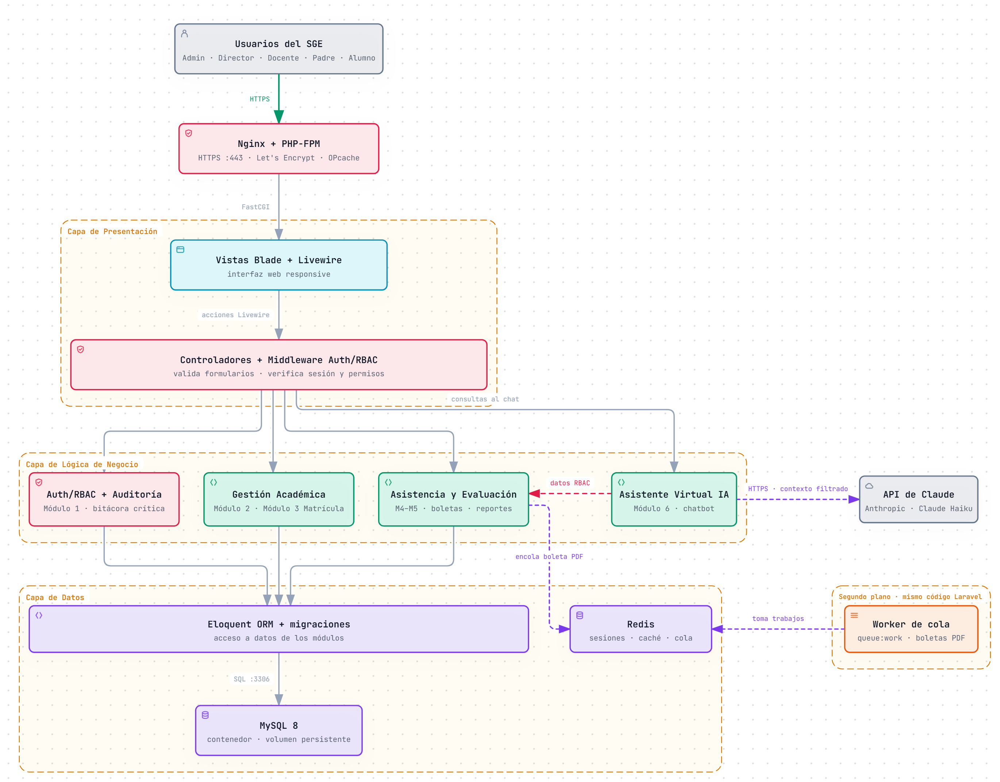
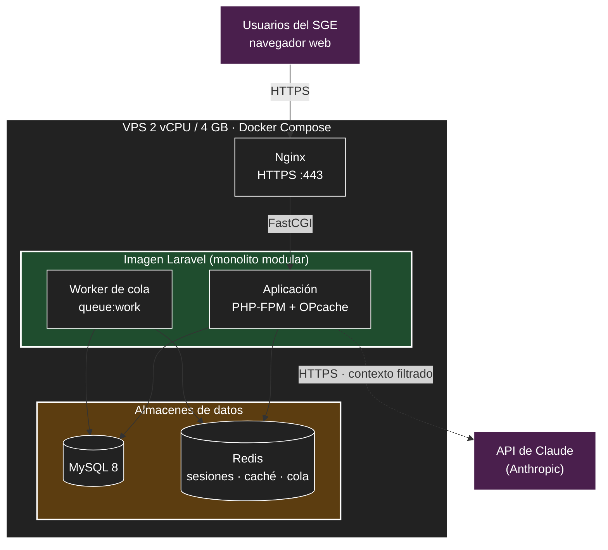

# Estilo arquitectónico

> **Pregunta guía:** ¿Cómo estructuramos globalmente el sistema?

El estilo arquitectónico es la **forma global de organización y despliegue** del sistema. No describe cómo se ordena el código por dentro; eso corresponde al [enfoque arquitectónico](enfoque-arquitectonico.md).

## Estilo seleccionado

El SGE es un **monolito modular organizado en capas**. Cada término describe algo distinto:

| Término | Qué describe | En el SGE |
|---------|--------------|-----------|
| **Monolito** | Cómo se despliega | Una sola aplicación Laravel (una misma imagen Docker) |
| **Modular** | División vertical por área de negocio | Autenticación, Gestión Académica, Matrícula, Asistencia, Evaluación y Asistente IA |
| **En capas** | División horizontal por responsabilidad técnica | Presentación → Lógica de negocio → Datos |

Cada módulo atraviesa las tres capas. Por ejemplo, cuando un docente registra una nota: el formulario de Evaluación y el middleware RBAC (presentación) → el caso de uso de Evaluación valida la escala y calcula el promedio (negocio) → la nota se guarda en MySQL (datos).

## Alternativas evaluadas

| Estilo | ¿Se adopta? | Motivo |
|--------|:-----------:|--------|
| **Monolito modular en capas** | **Sí** | Un solo despliegue, cabe en un VPS de bajo costo y permite separar módulos sin la complejidad de una red de servicios (DA05, DA06, DA09). |
| Microservicios | No | Varios despliegues, comunicación por red y monitoreo distribuido: no caben en dos meses (RC10) ni en un VPS de 2 vCPU / 4 GB (RC09). |
| Cliente-servidor con SPA + API REST | No | La restricción RC04 fija Blade y Livewire dentro del mismo proyecto; un frontend separado duplicaría el trabajo. |
| Serverless | No | Laravel con sesiones, cola y generación de PDF no encaja bien, y el costo por uso es poco predecible (RC09). |
| Dirigido por eventos | Parcial | No es el estilo global, pero se usa de forma puntual: cola para las boletas PDF (ADR-007) y eventos para la auditoría (ADR-010). |

La decisión está registrada en [ADR-001](../01-analisis-de-sistema/07-decisiones-arquitectonicas.md#adr-001--monolito-modular).

## Diagrama del estilo

Vista global: componentes principales del sistema y cómo se relacionan.

Versión interactiva: [`img/fuentes/sge-arquitectura-inicial.html`](../img/fuentes/sge-arquitectura-inicial.html).

### Vista de despliegue

Los cinco contenedores del monolito. La aplicación y el worker usan la **misma imagen**: es un solo sistema, no dos servicios.

## Relación con los drivers

| Driver | Cómo lo atiende el estilo |
|--------|---------------------------|
| DA05 Laravel + Blade/Livewire | Una sola aplicación, sin frontend separado. |
| DA06 Docker de bajo costo | Cinco contenedores en un solo servidor. |
| DA09 Mantenibilidad | Módulos con responsabilidades separadas; se puede agregar uno nuevo (p. ej. Pensiones) sin rehacer los demás. |
| DA03 Rendimiento | El monolito evita llamadas de red entre módulos; Redis y la cola son parte del mismo despliegue. |

## Limitaciones aceptadas

- Todos los módulos escalan juntos: no se puede dar más recursos solo a Evaluación.
- Un fallo grave de la aplicación afecta a todos los módulos.
- Los límites entre módulos no los impone la red, sino las reglas del [enfoque arquitectónico](enfoque-arquitectonico.md).
