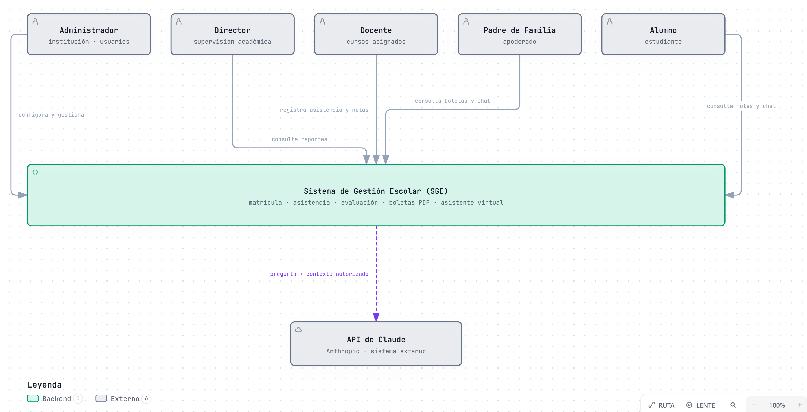

# Nivel 1 · Diagrama de contexto del sistema

> **Proyecto:** Sistema de Gestión Escolar (SGE)
> **Modelo:** C4 · Nivel 1 de 4

## 1. Objetivo

Mostrar el **SGE como una sola caja**: quiénes lo usan y con qué sistemas externos se comunica. Es la vista de mayor nivel y la primera que se presenta a cualquier persona, técnica o no.

| Aspecto | Descripción |
|---|---|
| Pregunta que responde | ¿Qué es el sistema, quién lo usa y con quién se integra? |
| Audiencia | Todos: dirección del colegio, docente del curso, equipo de desarrollo |
| Qué **no** muestra | Tecnologías, servidores, bases de datos ni módulos internos |
| Siguiente nivel | [`Nivel2-DiagramadeContenedores.md`](Nivel2-DiagramadeContenedores.md) |

## 2. Diagrama

> Fuente editable: [`img/fuentes/nivel1-contexto.archify.json`](../img/fuentes/nivel1-contexto.archify.json) · versión interactiva: [`nivel1-contexto.html`](../img/fuentes/nivel1-contexto.html)

## 3. Personas (usuarios)

| Persona | Descripción | Qué hace en el sistema | Historias |
|---|---|---|---|
| **Administrador** | Responsable de la configuración del sistema | Configura la institución, el año escolar y los catálogos; gestiona usuarios, roles y permisos | HU02–HU06 |
| **Director** | Supervisión académica | Consulta reportes consolidados de matrícula, asistencia y rendimiento | HU17 |
| **Docente** | Profesor con cursos asignados | Registra asistencia y notas de sus cursos y secciones | HU09–HU12 |
| **Padre de Familia** | Apoderado de uno o más estudiantes | Consulta notas, asistencia y boletas de sus hijos; usa el asistente virtual | HU13–HU16 |
| **Alumno** | Estudiante matriculado | Consulta sus notas y asistencia; usa el asistente virtual | HU13–HU15 |

## 4. Sistemas

| Sistema | Tipo | Responsabilidad | Quién lo construye |
|---|---|---|---|
| **SGE** | Sistema en alcance | Gestiona matrícula, asistencia, evaluación y boletas de una institución, con un asistente virtual | El proyecto |
| **API de Claude** | Sistema externo | Genera respuestas en lenguaje natural para el asistente virtual | Anthropic |

## 5. Relaciones

| Origen | Destino | Descripción | Origen en el análisis |
|---|---|---|---|
| Administrador | SGE | Configura la institución y gestiona usuarios | RF03–RF08 |
| Director | SGE | Consulta reportes | RF21 |
| Docente | SGE | Registra asistencia y notas | RF12, RF15 |
| Padre de Familia | SGE | Consulta boletas y conversa con el asistente | RF17–RF19 |
| Alumno | SGE | Consulta notas y asistencia, y conversa con el asistente | RF18, RF19 |
| SGE | API de Claude | Envía la pregunta junto con el contexto autorizado para ese usuario | RF20, DA02 |

> En el nivel 1 no se indican protocolos: eso se detalla en el nivel 2.

## 6. Decisiones y supuestos

| # | Decisión o supuesto | Motivo |
|---|---|---|
| 1 | La API de Claude es el único sistema externo | El MVP no integra pagos, correo ni sistemas del Ministerio de Educación (RC17) |
| 2 | Una instalación atiende a una sola institución | El sistema es configurable pero no multi-tenant (RC13) |
| 3 | Los cinco roles usan el mismo sistema web | Interfaz responsive única, sin aplicación móvil nativa (RC01, AC08) |
