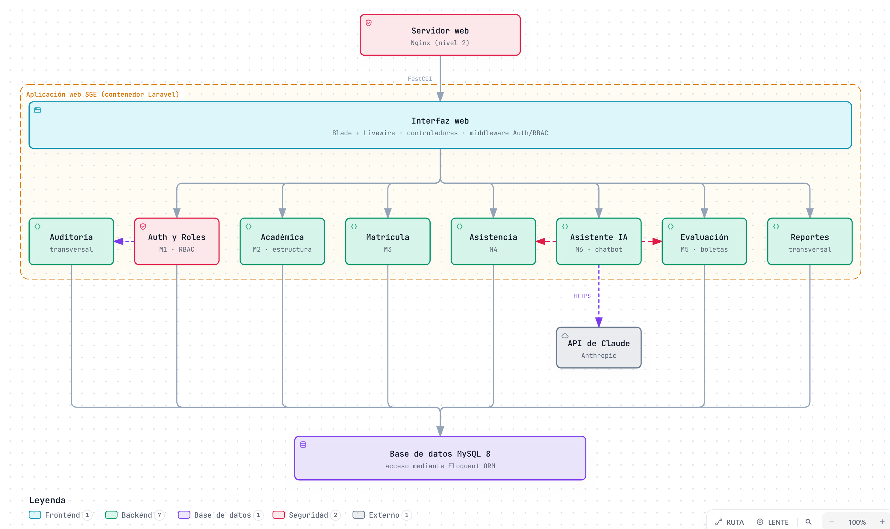

# Nivel 3 · Diagrama de componentes

> **Proyecto:** Sistema de Gestión Escolar (SGE) · **Contenedor detallado:** Aplicación web SGE
> **Modelo:** C4 · Nivel 3 de 4

## 1. Objetivo

Abrir el contenedor **Aplicación web SGE** del nivel 2 y mostrar sus **componentes**: los módulos del monolito, la responsabilidad de cada uno, de qué requisito salen y cómo se relacionan.

| Aspecto | Descripción |
|---|---|
| Pregunta que responde | ¿Cómo se divide la aplicación por dentro y qué hace cada parte? |
| Audiencia | Arquitectura y desarrollo |
| Qué es un componente | Un grupo de funcionalidades con una responsabilidad clara. En el SGE, cada **módulo** del monolito es un componente |
| Nivel anterior | [`Nivel2-DiagramadeContenedores.md`](Nivel2-DiagramadeContenedores.md) |
| Siguiente nivel | [`Nivel4-DiagramadeCodigo.md`](Nivel4-DiagramadeCodigo.md) |

## 2. Diagrama

> Fuente editable: [`img/fuentes/nivel3-componentes.archify.json`](../img/fuentes/nivel3-componentes.archify.json) · versión interactiva: [`nivel3-componentes.html`](../img/fuentes/nivel3-componentes.html)

## 3. Componentes y de dónde salen

| Componente | Responsabilidad | Requisitos | Drivers | Diseño interno | Carpeta en el código |
|---|---|---|---|---|---|
| **Interfaz web** | Pantallas Blade + Livewire, controladores y middleware Auth/RBAC; punto de entrada de toda solicitud | RF01, RF02 | DA01, DA05 | — | `app/Http/`, `resources/views/` |
| **Autenticación y Roles** (M1) | Inicio de sesión, usuarios, roles y permisos configurables | RF01–RF04 | DA01 | Simplificado | `app/Modulos/Autenticacion/` |
| **Gestión Académica** (M2) | Institución, año escolar, periodos, escala, niveles, grados, secciones, cursos y asignación docente | RF05–RF08 | DA04 | Simplificado | `app/Modulos/GestionAcademica/` |
| **Matrícula** (M3) | Estudiantes, apoderados, matrícula por sección y traslados con historial | RF09–RF11 | DA04 | Completo | `app/Modulos/Matricula/` |
| **Asistencia** (M4) | Registro diario por sección y curso, tipos de asistencia y reportes | RF12–RF14, RF18 | — | Simplificado | `app/Modulos/Asistencia/` |
| **Evaluación y Boletas** (M5) | Notas por competencia, escala, promedios y boleta PDF en cola | RF15–RF18 | DA03, DA07 | Completo | `app/Modulos/Evaluacion/` |
| **Asistente IA** (M6) | Arma el contexto autorizado y consulta la API de Claude | RF19, RF20 | DA02 | Completo | `app/Modulos/AsistenteIA/` |
| **Reportes** | Reportes consolidados para el director | RF21 | — | Simplificado | `app/Modulos/Reportes/` |
| **Auditoría** | Bitácora de acciones críticas a partir de eventos | RF22 | DA08 | Simplificado | `app/Modulos/Auditoria/` |

«Completo» y «Simplificado» indican el nivel de Clean Architecture de cada módulo (ADR-002).

## 4. Relaciones entre componentes

| Origen | Destino | Descripción | Tipo de comunicación |
|---|---|---|---|
| Servidor web | Interfaz web | Entrega la solicitud | FastCGI |
| Interfaz web | Módulos | Invoca los casos de uso después de verificar permisos | Llamada en memoria |
| Asistente IA | Asistencia, Evaluación | Pide solo los datos que el usuario puede ver (líneas rojas del diagrama) | Llamada en memoria (Facade de cada módulo) |
| Matrícula, Asistencia, Evaluación | Gestión Académica | Usan grados, secciones, cursos, periodos y escala | Llamada en memoria |
| Asistencia, Evaluación | Matrícula | Consultan qué estudiantes pertenecen a cada sección | Llamada en memoria |
| Autenticación, Evaluación | Auditoría | Publican eventos de acciones críticas | Evento en memoria |

> Las dependencias hacia Gestión Académica y Matrícula se describen en la tabla y no se dibujan, para que el diagrama siga siendo legible.

## 5. Relaciones con contenedores y sistemas externos

| Componente | Contenedor o sistema | Descripción |
|---|---|---|
| Todos excepto Asistente IA | Base de datos MySQL | Persisten y consultan sus datos mediante Eloquent |
| Autenticación y Roles | Redis | Sesiones y caché de permisos (nivel 2) |
| Evaluación y Boletas | Redis y worker de cola | Encola la generación de boletas (nivel 2) |
| Asistente IA | API de Claude | Envía la pregunta con el contexto autorizado por HTTPS |

El **Asistente IA no accede a la base de datos**: solo obtiene datos a través de Asistencia y Evaluación. Así un único punto decide qué información sale del sistema (DA02).
