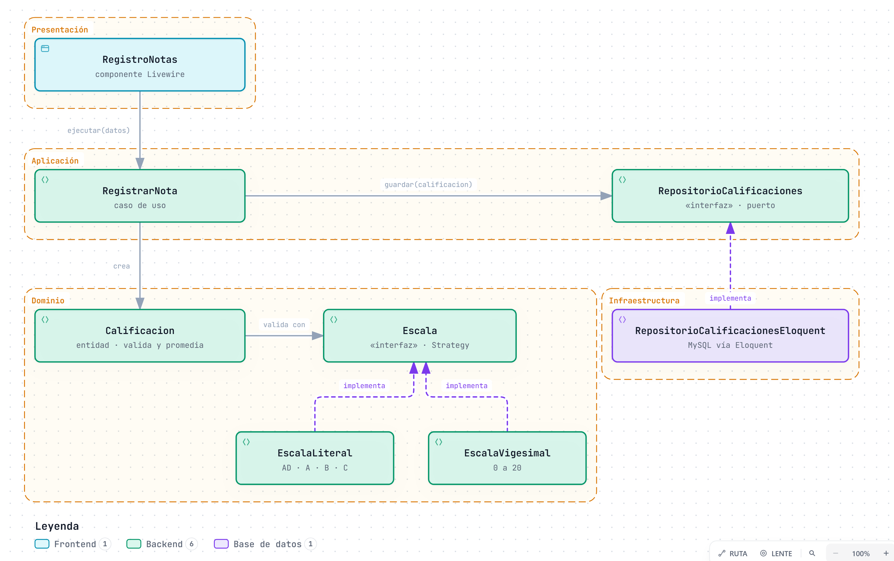
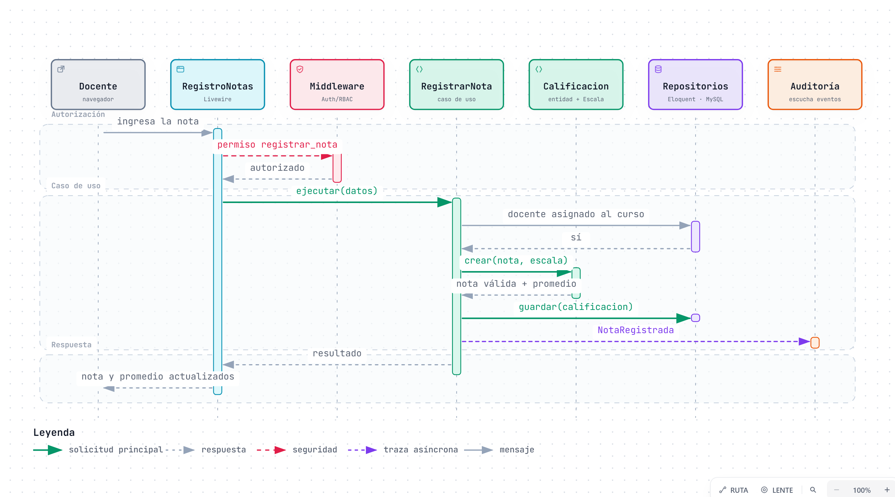

# Nivel 4 · Diagrama de código

> **Proyecto:** Sistema de Gestión Escolar (SGE) · **Módulo detallado:** Evaluación y Boletas
> **Modelo:** C4 · Nivel 4 de 4

## 1. Objetivo

Mostrar **cómo está organizado el código** de un componente del nivel 3: sus clases, interfaces y la forma en que colaboran. Se detalla el flujo **Registrar nota** del módulo Evaluación y Boletas.

| Aspecto | Descripción |
|---|---|
| Pregunta que responde | ¿Qué clases existen dentro de un módulo y cómo se relacionan? |
| Audiencia | Desarrollo |
| Diagramas | Diagrama de clases y diagrama de secuencia |
| Por qué solo un módulo | El nivel 4 es opcional en C4 y se dibuja solo para los componentes más importantes. Evaluación concentra las reglas de escala y promedio, y es la base del ejemplo ejecutable de [`tecnologia/`](../../tecnologia/ejemplo-clean-architecture/). Matrícula y Asistente IA siguen la misma estructura |
| Nivel anterior | [`Nivel3-Diagrama-de-Componentes.md`](Nivel3-Diagrama-de-Componentes.md) |

## 2. Diagrama de clases

> Fuente editable: [`img/fuentes/nivel4-clases-evaluacion.archify.json`](../img/fuentes/nivel4-clases-evaluacion.archify.json) · versión interactiva: [`nivel4-clases-evaluacion.html`](../img/fuentes/nivel4-clases-evaluacion.html)

### 2.1 Capas de Clean Architecture

| Capa | Contiene | Regla |
|---|---|---|
| **Presentación** | Componentes Livewire y controladores | Traduce el formulario en una llamada al caso de uso |
| **Aplicación** | Casos de uso y puertos (interfaces) | Coordina los pasos; no conoce Laravel ni Eloquent |
| **Dominio** | Entidades, escalas y eventos | Contiene las reglas del negocio; no importa nada de otras capas |
| **Infraestructura** | Repositorios y adaptadores | Implementa los puertos con una tecnología concreta |

> **Regla de dependencia:** las flechas del código apuntan hacia el dominio. Las clases de infraestructura implementan interfaces de la aplicación (línea discontinua); el dominio nunca conoce a la infraestructura.

### 2.2 Clases del módulo Evaluación

| Clase | Tipo | Capa | Responsabilidad |
|---|---|---|---|
| `RegistroNotas` | Componente Livewire | Presentación | Recibe la nota del docente y muestra el promedio actualizado |
| `RegistrarNota` | Caso de uso | Aplicación | Verifica la asignación, crea la calificación, la guarda, calcula el promedio y publica el evento |
| `RepositorioCalificaciones` | Interfaz (puerto) | Aplicación | Contrato para guardar y consultar calificaciones |
| `AsignacionDocente` | Interfaz (puerto) | Aplicación | Contrato para verificar si un docente tiene un curso y sección |
| `PublicadorEventos` | Interfaz (puerto) | Aplicación | Contrato para publicar eventos de dominio |
| `Calificacion` | Entidad | Dominio | Valida la nota con la escala y calcula el promedio |
| `Escala` | Interfaz (Strategy) | Dominio | Contrato de una escala de calificación |
| `EscalaLiteral` | Estrategia | Dominio | Escala AD · A · B · C |
| `EscalaVigesimal` | Estrategia | Dominio | Escala de 0 a 20 |
| `NotaRegistrada` | Evento de dominio | Dominio | Datos del cambio para la auditoría |
| `RepositorioCalificacionesEloquent` | Repositorio | Infraestructura | Implementa `RepositorioCalificaciones` con Eloquent y MySQL |

### 2.3 Notación utilizada

| Elemento | Significado |
|---|---|
| Línea continua con flecha | Usa, invoca o crea |
| Línea discontinua con flecha | Implementa una interfaz |
| «interfaz» | Contrato sin implementación |
| Región punteada | Capa de Clean Architecture |

## 3. Diagrama de secuencia: registrar una nota

> Fuente editable: [`img/fuentes/nivel4-secuencia-registrar-nota.archify.json`](../img/fuentes/nivel4-secuencia-registrar-nota.archify.json) · versión interactiva: [`nivel4-secuencia-registrar-nota.html`](../img/fuentes/nivel4-secuencia-registrar-nota.html)

| Paso | Qué ocurre | Requisito |
|---|---|---|
| 1–3 | El middleware verifica que el docente tenga el permiso `registrar_nota` | RF02, DA01 |
| 4–6 | El caso de uso verifica que el docente esté asignado a ese curso y sección | RF08, AC01 |
| 7–8 | `Calificacion` valida la nota con la escala de la institución y recalcula el promedio | RF15, RF16 |
| 9 | El repositorio guarda la calificación | RC05 |
| 10 | Se publica `NotaRegistrada` y Auditoría la registra | RF22, DA08 |
| 11–12 | El docente ve la nota y el promedio actualizados | RF16 |

## 4. Del diagrama al código

El ejemplo ejecutable [`tecnologia/ejemplo-clean-architecture/`](../../tecnologia/ejemplo-clean-architecture/) implementa este diagrama en PHP sin Laravel: las clases de Dominio y Aplicación son las mismas, y la Infraestructura usa implementaciones en memoria en lugar de Eloquent. Sus pruebas de Pest verifican las reglas y la regla de dependencia.
